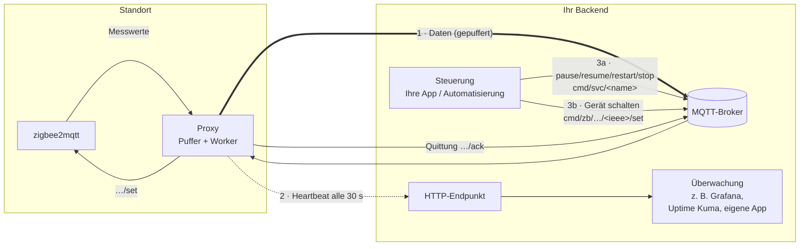

# Erweiterte Nutzung: Anbindung an ein eigenes Backend

[🇬🇧 English](backend_en.md) · Konfiguration: [configuration.md](configuration.md) · Betrieb: [betrieb.md](betrieb.md)

Für das reine Weiterleiten braucht es diese Seite nicht: Der Proxy puffert die Zigbee-Daten und
gibt sie an einen MQTT-Broker oder HTTP-Endpunkt weiter — fertig. Diese Seite ist für alle, die
den Proxy **aus der Ferne überwachen und steuern** oder **Geräte über ihn schalten** wollen. Dafür
bietet er drei zusätzliche Kanäle, jeder einzeln abschaltbar. Welches Backend dahinter steht,
ist dem Proxy egal; es muss nur die hier beschriebenen Formate sprechen.

## Überblick



| Kanal | Richtung | Weg | Zweck | Abschalten |
|---|---|---|---|---|
| 1 · Daten | Proxy → Backend | MQTT oder HTTP | Messwerte, gepuffert, mit Messzeit | — |
| 2 · Heartbeat | Proxy → Backend | HTTP `POST` | „Lebt der Proxy, leitet er weiter?" | `monitor.enabled: false` |
| 3a · Fernsteuerung | Backend → Proxy | MQTT `cmd/svc/<name>` | Versand anhalten, fortsetzen, neu starten | `monitor.control: false` |
| 3b · Rückweg | Backend → Gerät | MQTT `cmd/zb/…/set` | Lampen, Steckdosen, Rollläden schalten | `control.enabled: false` |

Die Kanäle 3a und 3b laufen über **dieselbe Verbindung** zum Upstream-Broker wie die Daten — am
Standort ist kein Port zu öffnen.

## 1 · Daten

- **MQTT** (`mode: mqtt`): Topic und Nutzlast wie von zigbee2mqtt, QoS 1; Zugang über
  `mqtt.username` / `mqtt.password`. Die Messzeit geht je nach `mqtt.timestamp_mode` als MQTT-5-
  User-Property `ts` oder als JSON-Feld mit.
- **HTTP** (`mode: http`): `POST` an `http.endpoint`, Header `X-Ingest-Token: <http.token>`. Aus
  jeder zigbee2mqtt-Nachricht werden die Zahlen- und Ja/Nein-Werte:

  ```json
  {"device": "wohnzimmer_temp",
   "readings": [{"key": "temperature", "value": 21.4, "ts": "2026-11-28T09:15:00Z"},
                {"key": "occupancy",   "value": 1,    "ts": "2026-11-28T09:15:00Z"}]}
  ```

  Antwortet der Endpunkt mit 2xx, ist die Nachricht zugestellt; 400/413/415/422 gelten als
  endgültig abgelehnt (abgelegt in `dead-letter.jsonl`), alles andere wird wiederholt.

**Mehrere Ziele:** Mit [Routen](configuration.md#routen-mehrere-ziele-von-einem-standort) geht ein
Teil der Geräte zusätzlich an ein anderes Ziel, mit eigenem Zugang, eigenem Puffer und eigenem
Geräte-Filter — etwa alle Geräte ins eigene System, eine Auswahl an einen Kunden oder Partner.

## 2 · Heartbeat

Alle `monitor.interval_s` Sekunden (Vorgabe 30) ein `POST` an `monitor.ingest_url` (Vorgabe:
`http.endpoint`), Header `X-Ingest-Token: <monitor.token>` (Vorgabe: `http.token` bzw.
`mqtt.password`). Format wie beim HTTP-Daten-Kanal:

```json
{"device": "svc-edgeproxy",
 "readings": [{"key": "service_up", "value": 1}, {"key": "service_state", "value": 1}, …],
 "meta": {"svc_product": "mlc2afmqttproxy", "svc_version": "1.5.0"}}
```

| Schlüssel | Bedeutung |
|---|---|
| `service_up` | immer 1 — bleibt der Heartbeat aus, ist der Proxy (oder das Netz) weg |
| `service_state` | 1 läuft · 2 pausiert · 3 leert |
| `svc_uptime_s` | Laufzeit seit dem Start |
| `svc_buffer_pending`, `svc_buffer_mb` | Nachrichten bzw. MB im Puffer |
| `svc_upstream_connected`, `svc_zigbee_connected` | 1/0 — Upstream erreichbar, zigbee2mqtt verbunden |
| `svc_last_forward_age_s`, `svc_last_receive_age_s` | Sekunden seit der letzten Weiterleitung bzw. dem letzten Empfang (fehlen bis zum ersten Mal) |
| `svc_forward_failed_total`, `svc_dropped_full_total`, `svc_dead_lettered_total` | Fehlversuche, wegen vollem Puffer verworfen, endgültig abgelehnt |

Ein Proxy kann „läuft" melden und trotzdem nichts weiterleiten — die Werte zeigen es.
**Typische Auswertung:** Alarm, wenn der Heartbeat länger als 2–3 Intervalle ausbleibt, wenn
`svc_buffer_pending` stetig wächst oder `svc_last_forward_age_s` groß wird. Wer kein eigenes
Backend hat, liest dieselben Werte per Abruf: `GET /api/v1/status` (z. B. für Uptime Kuma oder
eine Grafana-JSON-Datenquelle).

## 3a · Fernsteuerung

Der Proxy abonniert `cmd/svc/<name>` (`<name>` = `monitor.device` ohne `svc-`, Vorgabe
`edgeproxy`). Mit `monitor.customer_number` liegt das Topic eine Ebene tiefer,
`cmd/svc/<wert>/<name>` — für Broker, die jedem Zugang nur einen eigenen Zweig erlauben.

```json
→ cmd/svc/edgeproxy      {"action": "pause", "command_id": "c-17"}
← cmd/svc/edgeproxy/ack  {"service": "edgeproxy", "action": "pause", "command_id": "c-17",
                          "status": "ok", "error": "", "state": 2}
```

| `action` | Wirkung |
|---|---|
| `pause` / `drain` | Versand ruht, eingehende Daten bleiben im Puffer (kein Verlust); endet spätestens nach `monitor.max_pause_minutes` (60) von selbst |
| `resume` | Versand läuft wieder, der Puffer leert sich mit den ursprünglichen Zeiten |
| `restart` | geordnet beenden, Exit-Code 75 (systemd/Docker startet neu) |
| `stop` | geordnet beenden, Exit-Code 0 (bleibt aus) |

Unbekannte Aktionen quittiert der Proxy mit `"status": "unknown"`. Gespeicherte (retained)
Befehle führt er nie aus — sie kämen sonst bei jedem Neustart wieder.

## 3b · Rückweg: Geräte schalten

```
Backend ──cmd/zb/<…>/<ieee>/set──▶ Proxy ──zigbee2mqtt/<gerät>/set──▶ zigbee2mqtt ──▶ Gerät
   ▲                                 │                                                  │
   └──────cmd/zb/<…>/<ieee>/ack──────┘◀──────── zigbee2mqtt/<gerät> {"state":"ON"} ──────┘
```

1. Das Backend schickt z. B. `{"state":"ON","_id":"a1b2"}` an `cmd/zb/<…>/<ieee>/set`. Zwischen
   `cmd/zb/` und der IEEE-Adresse darf beliebig viel stehen (z. B. eine Kunden- oder
   Standortkennung). `_id` ist Pflicht und geht nicht an zigbee2mqtt.
2. Der Proxy abonniert `control.subscribe` (Vorgabe `cmd/zb/#`) über die Verbindung des
   Haupt-Upstreams und jeder Route.
3. Er prüft: Gerät erlaubt (Route: nur ihre `devices`), Feld erlaubt (`control.allow`, Vorgabe:
   Bedienfelder), laut zigbee2mqtt setzbar, Gerät online, höchstens `control.per_minute` Befehle.
4. Er übersetzt die IEEE-Adresse in den Namen bei zigbee2mqtt und schickt die Felder an
   `zigbee2mqtt/<gerät>/set`.
5. Die Quittung geht auf dasselbe Topic mit `/ack`:
   - `{"id":"a1b2","result":"ok","state":{"state":"ON"}}` — erst, wenn das Gerät den Zustand meldet,
   - `timeout` — keine passende Meldung binnen `control.timeout_s` (10 s), mit dem letzten Zustand,
   - `rejected` mit `reason`: `device not allowed`, `field not allowed: …`,
     `field not writable on this device: …`, `device unknown to zigbee2mqtt`, `device offline`,
     `rate limit`, `zigbee2mqtt not reachable`, `missing _id`, `invalid payload: JSON object expected`,
     `no fields to set`.

**Der Proxy schaltet nie selbst** — keine Regeln, keine Zeitpläne. Befehle werden **nie
gepuffert**: retained wird verworfen, und was während eines Ausfalls geschickt wird, kommt nie
verspätet an (Verbindung ohne gespeicherte Sitzung). Welche Felder erlaubt sind:
[configuration.md › Rückweg](configuration.md#rückweg-geräte-aus-dem-upstream-schalten).

## Was Ihr Broker absichern muss

Der Proxy prüft Geräte und Felder — **wer** Befehle schicken darf, entscheidet Ihr Broker:

- `cmd/svc/…` und `cmd/zb/…/set` darf nur Ihr Backend schreiben, nicht andere Zugänge.
- Hängen mehrere Standorte am selben Broker, stellt er jedem Zugang nur dessen eigenen Zweig zu
  (sonst schaltet Standort A die Geräte von Standort B). Der Proxy schreibt nur `…/ack`.
- Wer `cmd/zb/…/set` im Zweig eines Standorts schreiben kann, schaltet alle dort freigegebenen
  Geräte.

## Prüfen

- Protokoll beim Start: `[svcmon] Fernsteuerung aktiv: cmd/svc/edgeproxy`,
  `[control main] abonniert: cmd/zb/#`. Lehnt der Broker ein Abo ab:
  `Abo cmd/zb/# vom Broker ABGELEHNT (0x87)` — dem Zugang fehlt das Recht.
- Je Befehl: `[control main] 0x… map[state:ON] → ok`.
- Oberfläche, Tab **Filters**: Karte „Remote control" mit Umfang, Zählern und den letzten Befehlen
  (`/api/v1/control`).
