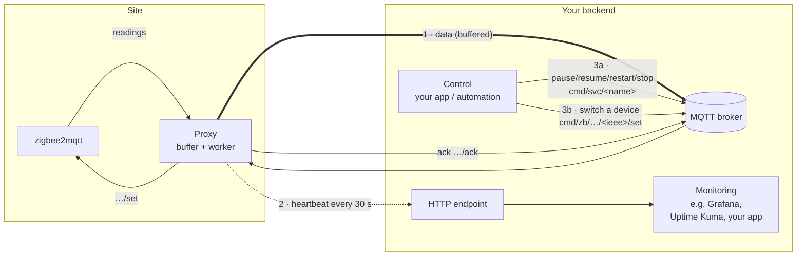

# Advanced use: connecting your own backend

[🇩🇪 Deutsch](backend.md) · Configuration: [configuration_en.md](configuration_en.md) · Operation: [betrieb_en.md](betrieb_en.md)

Plain forwarding does not need this page: the proxy buffers the Zigbee data and passes it to an
MQTT broker or HTTP endpoint — done. This page is for anyone who wants to **monitor and control
the proxy remotely** or **switch devices through it**. For that it offers three additional
channels, each of which can be switched off. The proxy does not care which backend is behind
them; it only has to speak the formats described here.

## Overview



| Channel | Direction | Transport | Purpose | Switch off |
|---|---|---|---|---|
| 1 · Data | proxy → backend | MQTT or HTTP | readings, buffered, with measurement time | — |
| 2 · Heartbeat | proxy → backend | HTTP `POST` | "Is the proxy alive, is it forwarding?" | `monitor.enabled: false` |
| 3a · Remote control | backend → proxy | MQTT `cmd/svc/<name>` | pause, resume, restart forwarding | `monitor.control: false` |
| 3b · Return path | backend → device | MQTT `cmd/zb/…/set` | switch lights, plugs, blinds | `control.enabled: false` |

Channels 3a and 3b use **the same connection** to the upstream broker as the data — no port has
to be opened at the site.

## 1 · Data

- **MQTT** (`mode: mqtt`): topic and payload as sent by zigbee2mqtt, QoS 1; access via
  `mqtt.username` / `mqtt.password`. Depending on `mqtt.timestamp_mode` the measurement time goes
  along as MQTT 5 user property `ts` or as a JSON field.
- **HTTP** (`mode: http`): `POST` to `http.endpoint`, header `X-Ingest-Token: <http.token>`. Each
  zigbee2mqtt message is reduced to its numeric and boolean values:

  ```json
  {"device": "living_room_temp",
   "readings": [{"key": "temperature", "value": 21.4, "ts": "2026-11-28T09:15:00Z"},
                {"key": "occupancy",   "value": 1,    "ts": "2026-11-28T09:15:00Z"}]}
  ```

  A 2xx answer means delivered; 400/413/415/422 count as permanently rejected (kept in
  `dead-letter.jsonl`), everything else is retried.

**Several targets:** with [routes](configuration_en.md) some of the devices additionally go to
another target, with its own access, buffer and device filter — for example all devices into
your own system and a selection to a customer or partner.

## 2 · Heartbeat

Every `monitor.interval_s` seconds (default 30) a `POST` to `monitor.ingest_url` (default:
`http.endpoint`), header `X-Ingest-Token: <monitor.token>` (default: `http.token` or
`mqtt.password`). Same format as the HTTP data channel:

```json
{"device": "svc-edgeproxy",
 "readings": [{"key": "service_up", "value": 1}, {"key": "service_state", "value": 1}, …],
 "meta": {"svc_product": "mlc2afmqttproxy", "svc_version": "1.5.0"}}
```

| Key | Meaning |
|---|---|
| `service_up` | always 1 — if the heartbeat stops, the proxy (or the network) is gone |
| `service_state` | 1 running · 2 paused · 3 draining |
| `svc_uptime_s` | uptime since start |
| `svc_buffer_pending`, `svc_buffer_mb` | messages / MB in the buffer |
| `svc_upstream_connected`, `svc_zigbee_connected` | 1/0 — upstream reachable, zigbee2mqtt connected |
| `svc_last_forward_age_s`, `svc_last_receive_age_s` | seconds since the last forward / receive (missing until the first one) |
| `svc_forward_failed_total`, `svc_dropped_full_total`, `svc_dead_lettered_total` | failed attempts, dropped because the buffer was full, permanently rejected |

A proxy can report "running" and still forward nothing — these values show it.
**Typical alerts:** heartbeat missing for more than 2–3 intervals, `svc_buffer_pending` growing
steadily, or `svc_last_forward_age_s` getting large. Without a backend of your own, poll the same
values: `GET /api/v1/status` (e.g. for Uptime Kuma or a Grafana JSON data source).

## 3a · Remote control

The proxy subscribes to `cmd/svc/<name>` (`<name>` = `monitor.device` without `svc-`, default
`edgeproxy`). With `monitor.customer_number` the topic moves one level down,
`cmd/svc/<value>/<name>` — for brokers that give each account only its own branch.

```json
→ cmd/svc/edgeproxy      {"action": "pause", "command_id": "c-17"}
← cmd/svc/edgeproxy/ack  {"service": "edgeproxy", "action": "pause", "command_id": "c-17",
                          "status": "ok", "error": "", "state": 2}
```

| `action` | Effect |
|---|---|
| `pause` / `drain` | forwarding stops, incoming data stays in the buffer (no loss); ends by itself after `monitor.max_pause_minutes` (60) at the latest |
| `resume` | forwarding resumes, the buffer drains with the original times |
| `restart` | orderly exit, code 75 (systemd/Docker restarts it) |
| `stop` | orderly exit, code 0 (stays off) |

Unknown actions are acknowledged with `"status": "unknown"`. Stored (retained) commands are never
executed — they would come back on every restart.

## 3b · Return path: switching devices

```
Backend ──cmd/zb/<…>/<ieee>/set──▶ Proxy ──zigbee2mqtt/<device>/set──▶ zigbee2mqtt ──▶ Device
   ▲                                 │                                                    │
   └──────cmd/zb/<…>/<ieee>/ack──────┘◀──────── zigbee2mqtt/<device> {"state":"ON"} ───────┘
```

1. The backend sends e.g. `{"state":"ON","_id":"a1b2"}` to `cmd/zb/<…>/<ieee>/set`. Anything may
   sit between `cmd/zb/` and the IEEE address (e.g. a customer or site id). `_id` is required and
   is not passed to zigbee2mqtt.
2. The proxy subscribes to `control.subscribe` (default `cmd/zb/#`) over the connection of the
   main upstream and of every route.
3. It checks: device allowed (route: only its `devices`), field allowed (`control.allow`,
   default: controls), settable according to zigbee2mqtt, device online, at most
   `control.per_minute` commands.
4. It translates the IEEE address into the zigbee2mqtt name and sends the fields to
   `zigbee2mqtt/<device>/set`.
5. The acknowledgement goes to the same topic with `/ack`:
   - `{"id":"a1b2","result":"ok","state":{"state":"ON"}}` — only once the device reports the state,
   - `timeout` — no matching report within `control.timeout_s` (10 s), with the last state,
   - `rejected` with `reason`: `device not allowed`, `field not allowed: …`,
     `field not writable on this device: …`, `device unknown to zigbee2mqtt`, `device offline`,
     `rate limit`, `zigbee2mqtt not reachable`, `missing _id`, `invalid payload: JSON object expected`,
     `no fields to set`.

**The proxy never switches by itself** — no rules, no schedules. Commands are **never
buffered**: retained ones are dropped, and anything sent during an outage never arrives late
(connection without a stored session). Which fields are allowed:
[configuration_en.md › Return path](configuration_en.md#return-path-switching-devices-from-the-upstream).

## What your broker has to secure

The proxy checks devices and fields — **who** may send commands is decided by your broker:

- Only your backend may write `cmd/svc/…` and `cmd/zb/…/set`, not other accounts.
- If several sites share a broker, it delivers to each account only its own branch (otherwise
  site A switches the devices of site B). The proxy only writes `…/ack`.
- Whoever can write `cmd/zb/…/set` in a site's branch switches every device enabled there.

## Checking

- Log at start: `[svcmon] Fernsteuerung aktiv: cmd/svc/edgeproxy`,
  `[control main] abonniert: cmd/zb/#`. If the broker rejects a subscription:
  `Abo cmd/zb/# vom Broker ABGELEHNT (0x87)` — the account lacks the right.
- Per command: `[control main] 0x… map[state:ON] → ok`.
- UI, tab **Filters**: card "Remote control" with scope, counters and the latest commands
  (`/api/v1/control`).
