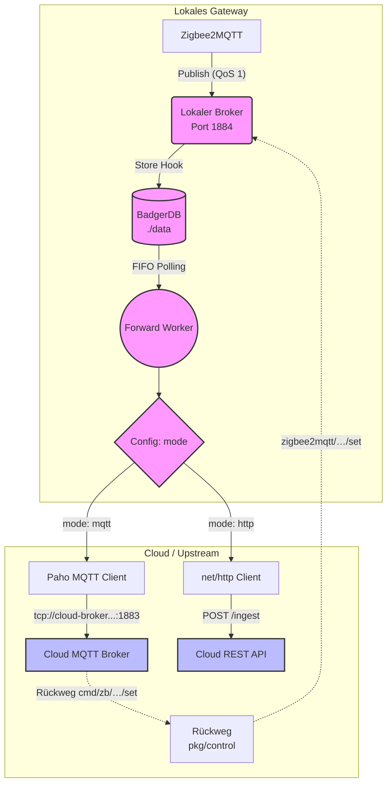

# Konfiguration (`config.yaml`)

[🇬🇧 Read this in English](configuration_en.md)
Der Proxy wird vollständig über eine zentrale `config.yaml` Datei gesteuert. Diese Datei muss im selben Verzeichnis wie das `proxy` Binary liegen.

## Konfigurations-Parameter

```yaml
# Die Betriebsart des Upstreams.
# Zulässige Werte: "http" oder "mqtt"
mode: "http"

# Hinweis zum MQTT-Modus & Zeitstempel:
# Da wir bei Store & Forward Offline-Daten nachreichen, ist der Zeitstempel wichtig.
# Die Option mqtt.timestamp_mode steuert das Verhalten:
# - "none": Standard MQTT v3.1.1, Zeitstempel wird ignoriert.
# - "json_inject": (Empfohlen) Entpackt den Payload (sofern JSON), fügt "ts" als Unix-Timestamp (ms) ein und packt ihn neu.
# - "v5_property": Sendet die Nachricht via MQTT v5 und übergibt den Zeitstempel (RFC3339) als "User Property" (ts).

server:
  # (Optional) Wenn false, wird das Web-Dashboard komplett deaktiviert (Standard: true)
  enable: true
  # (Optional) Die IP-Adresse, an die der Webserver gebunden werden soll (Standard: "0.0.0.0" für alle Interfaces).
  # Ohne username/password und mit public_stats: false gilt 127.0.0.1.
  host: "0.0.0.0"
  # Der Port für das Diagnostik-Web-Dashboard und die Health-API
  port: 8097
  # (Optional) Pfad-Präfix für die Diagnose-REST-API (Standard: "/api/v1")
  api_prefix: "/api/v1"
  # Öffentlich, ohne Anmeldung (seit 1.2.0, Standard an): Statistik — /status, /stats, /history und,
  # mit public_devices, /devices. So sieht der Kunde, ob der Proxy läuft und weiterleitet.
  # public_stats: true
  # public_devices: true
  # Anmeldung für den geschützten Teil: Live-Ansicht (/mqtt, alle MQTT-Inhalte), /config, /filters.
  # In der Seite (Session-Cookie, 12 h) oder per HTTP Basic Auth. Ohne Passwort gibt es den
  # geschützten Teil nur für Aufrufe von 127.0.0.1 — hinter einem Reverse Proxy immer ein Passwort setzen.
  # username: "admin"
  # password: "secret-password"

storage:
  # Pfad, in dem die BadgerDB ihre Daten ablegt (Store & Forward Puffer)
  path: "./data"
  # Maximale Größe der Datenbank in Megabyte (Default 1024)
  max_size_mb: 1024

mqtt:
  # Adresse des eingebetteten Brokers (TCP und WebSocket). Standard 127.0.0.1: z2m bzw. mqttbridge
  # auf derselben Box. Von Loopback geht es ohne Anmeldung, von jeder anderen Adresse nur mit einem
  # Konto aus local_users. Ist bind von außen erreichbar und local_users leer, startet der Proxy nicht.
  bind: "127.0.0.1"
  # local_users:
  #   - username: "z2m"          # in zigbee2mqtt: mqtt.user / mqtt.password
  #     password: "secret-password"
  # Der lokale Port, auf dem der eingebettete Mochi-Broker für Zigbee2MQTT lauscht.
  # Größte angenommene Nachricht: 1 MiB.
  local_port: 1884
  # (Optional) Client-ID am Upstream. Leer = "mlc2af-proxy-" + die ersten 12 Zeichen von /etc/machine-id
  # (sonst Hostname); Routen hängen "-route-<name>", die Steuerung "-ctl" an. Je Box eindeutig —
  # zwei Boxen mit derselben ID werfen sich am Broker gegenseitig hinaus.
  # client_id: "kunde-lager-1"
  # Upstream-Einstellungen (nur relevant wenn mode: "mqtt")
  upstream: "tcp://cloud-broker.example.com:1883"
  username: "user"
  password: "password"
  # Wie Zeitstempel an den MQTT Upstream gesendet werden (none, json_inject, v5_property)
  timestamp_mode: "v5_property"
  # Name des injizierten Zeitstempel-Feldes im JSON (Standard: "_ts").
  # Es wird "inject if absent" genutzt, d.h. wenn dieses Feld schon existiert, bleibt es unangetastet!
  timestamp_field: "_ts"
  # Aktiviert die Nutzung von MQTT 5 Topic Aliases zur massiven Reduktion der übertragenen Datenmenge
  topic_alias: true
  
  # Dedupliziert exakt gleiche Nachrichten auf dem gleichen Topic in diesem Zeitfenster (in ms).
  deduplicate_interval_ms: 1000
  # Smart JSON Deduplication: Diese Keys werden beim Byte-Vergleich ignoriert.
  deduplicate_ignore_keys:
    - last_seen
    - linkquality
  # Basis-Topic von zigbee2mqtt (z2m: mqtt.base_topic) für die Gerätestatistik (Standard: "zigbee2mqtt")
  # zigbee_base_topic: "zigbee2mqtt"
  
  # Optionale Rewrite-Policy für das Base-Topic (z.B. umleiten auf einen Namespace)
  topic_rewrite:
    match_prefix: "zigbee2mqtt/"
    replace_with: "/v1/bridgedataxxx/"

  # Optional: Filter-Regeln, um unnötige Topics (wie Logs) nicht zu speichern und nicht weiterzuleiten.
  # Werden auf das eingehende (originale) Topic angewandt, VOR dem eventuellen Rewrite.
  filter:
    # Whitelist: Topics MÜSSEN mit einem dieser Strings beginnen.
    allowed_prefixes:
      - "zigbee2mqtt/"
    # Blacklist: Topics DÜRFEN NICHT mit einem dieser Strings beginnen.
    ignored_prefixes:
      - "zigbee2mqtt/bridge/logging"
      - "zigbee2mqtt/bridge/state"


http:
  # Upstream-Einstellungen (nur relevant wenn mode: "http")
  endpoint: "https://api.example.com/ingest"
  # Optional: Wird als "Authorization: Bearer <token>" Header mitgesendet
  token: "my-secret-token"

worker:
  # (Optional) Das Intervall für den Hintergrund-Worker in Millisekunden (Standard: 100)
  interval_ms: 100
  # (Optional) Maximale Anzahl von Nachrichten, die in einem Durchlauf (Batch) gesendet werden (Standard: 100)
  max_batch_size: 50
  # (Optional) Künstliche Verzögerung in Millisekunden zwischen Nachrichten innerhalb eines Batches (Standard: 0)
  batch_delay_ms: 10
  # (Optional) Minimaler Backoff bei Fehlern oder Verbindungsunterbrechungen in Sekunden (Standard: 1)
  retry_min_s: 1
  # (Optional) Maximaler Backoff bei Fehlern oder Verbindungsunterbrechungen in Sekunden (Standard: 60)
  retry_max_s: 60

# (Optional) Zusätzliche Upstreams (Routen) neben dem Haupt-Upstream
routes:
  - name: demo                      # Pflicht; Puffer unter <storage.path>/routes/demo
    mode: "mqtt"                    # "mqtt" (Standard) oder "http"
    upstream: "tcp://cloud.example.com:1883"
    username: "demo"
    password: "<ingest-token>"
    topic_alias: true
    # http: { endpoint: "...", token: "..." }   # bei mode: "http"
    filter:                         # wirkt ZUSÄTZLICH zu mqtt.filter
      allowed_prefixes: ["zigbee2mqtt/"]
    devices:                        # nur diese Geräte (friendly_name wie im Topic, oder IEEE)
      - "0x00158d0000000001"
    base_topic: "zigbee2mqtt"       # Standard
    # control_allow: operate        # Rückweg dieser Route, wie control.allow; schaltet nur ihre devices
    # control:                      # Felder je Gerät (bei list: die einzige Freigabe)
    #   "0x00158d0000000001": [child_lock]

# (Optional) Rückweg: der Sensor Monitor schaltet Geräte über den Proxy. Standardmäßig AN,
# ohne Angaben nutzbar. Siehe „Rückweg" unten.
control:
  # enabled: true                  # false = Rückweg aus (auch für alle Routen)
  # allow: operate                 # operate (Vorgabe) | writable | list
  # devices:                       # Felder je Gerät: bei operate/writable zusätzlich, bei list allein
  #   "0x00158d0000000001": [child_lock]
  # broker: "tcp://127.0.0.1:1883" # nur, wenn zigbee2mqtt an einem ANDEREN Broker hängt
  # username: ""                   # Zugang zu diesem Broker
  # password: ""
  # subscribe: "cmd/zb/#"          # Befehls-Abo am Upstream (Vorgabe)
  # timeout_s: 10                  # so lange wartet die Quittung auf die Zustandsmeldung
  # per_minute: 10                 # höchstens so viele Befehle je Gerät und Minute
```

> `mqtt.downstream_config` gibt es seit 1.5 nicht mehr (es hat nie funktioniert) und wird mit
> einer Warnung ignoriert. Der Weg vom Upstream zu den Geräten ist der Rückweg.

### Rückweg: Geräte aus dem Monitor schalten

- **Was schaltbar ist** (`allow`):
  - `operate` (Vorgabe): an jedem Gerät des Mandanten die Bedienfelder `state`, `brightness`,
    `color_temp`, `color`, `position`, `state_<kanal>`.
  - `writable`: jedes Feld, das das Gerät selbst als setzbar meldet — auch Einstellungen und
    Kalibrierung.
  - `list`: nur Geräte und Felder aus `devices` (bei Routen `control`). **Nur so schränkt eine
    Liste ein**; ohne `list` ergänzt sie nur Felder. Per Vorgabe schränkt der Rückweg nie ein.
- **Welche Geräte:** beim Haupt-Upstream alle, die zigbee2mqtt kennt; bei einer Route nur ihre
  `devices`. Neu angelernte Geräte sind ohne Neustart schaltbar. Welche davon tatsächlich
  geschaltet werden, entscheidet der Monitor.
- In jedem Modus lehnt der Proxy ab, was das Gerät nicht setzen kann, was offline oder unbekannt
  ist und mehr als `per_minute` Befehle je Minute.
- **Wohin die Befehle gehen:** ohne `broker` in den eigenen Broker (zigbee2mqtt hängt am Proxy);
  mit `broker` an diesen, z. B. Mosquitto, an dem auch Home Assistant hängt.
- Ablauf, Quittung und Ablehnungsgründe: [mlc-sensor-monitor.md › Geräte schalten](mlc-sensor-monitor.md#geräte-schalten-rückweg).

### Routen: mehrere Ziele von einem Standort

Ein Standort mit **einem** Zigbee-Netz kann Daten an **mehrere Ziele** geben, etwa an zwei
Mandanten: das vollständige Testlabor und eine Demo mit ausgewählten Geräten.

- **Eigener Puffer und Worker je Route.** Fällt ein Ziel aus, puffert nur dessen Route; die
  anderen senden weiter. Kein Datenverlust je Ziel.
- **Reihenfolge der Regeln:** Zuerst gelten globaler Filter und Entprellung (`mqtt.filter`,
  `deduplicate_*`). Was dort durchkommt, geht an den Haupt-Upstream und **zusätzlich** an
  jede Route, deren eigene Regeln es erfüllt.
- **`devices`:** Dann gehen nur `<base>/<gerät>` und `<base>/<gerät>/…` hinaus (Werte,
  `availability`, …) sowie ein **auf diese Geräte gekürztes** `<base>/bridge/devices`.
  Sonst würde das Ziel alle Geräte des Standorts anlegen. Alle anderen `bridge/*`-Meldungen
  (`bridge/info` enthält die z2m-Konfiguration) gehen über eine Route mit Geräteliste **nie**
  hinaus. Die Werte kommen unter dem `friendly_name` aus z2m. Ein Eintrag per **IEEE-Adresse**
  folgt dem Gerät auch nach einem Umbenennen: Die Route liest aus dem jüngsten
  `bridge/devices`, welchen Namen das Gerät gerade trägt. Bis nach einem Neustart des Proxys
  die erste Liste eintrifft, greift die IEEE-Adresse nur, solange friendly_name und IEEE
  gleich sind (z2m-Standard). Ein Eintrag per Anzeigename gilt nur für genau diesen Namen —
  **IEEE ist deshalb der bessere Eintrag.**
- **Rückweg je Route:** Jede Route nimmt über ihre eigene Verbindung Befehle für **ihre**
  Geräte an. Die Fernsteuerung des Proxys (`cmd/svc/…`) läuft nur über den Haupt-Upstream. `pause`/`drain` aus der Fernsteuerung gelten für alle Worker.

## Architektur-Diagramm nach Betriebsart

Die Einstellung `mode` entscheidet darüber, über welchen Weg der Worker die Daten an die Cloud überträgt. Der lokale Datenfluss (Zigbee2MQTT -> Mochi -> BadgerDB) bleibt dabei immer identisch.


