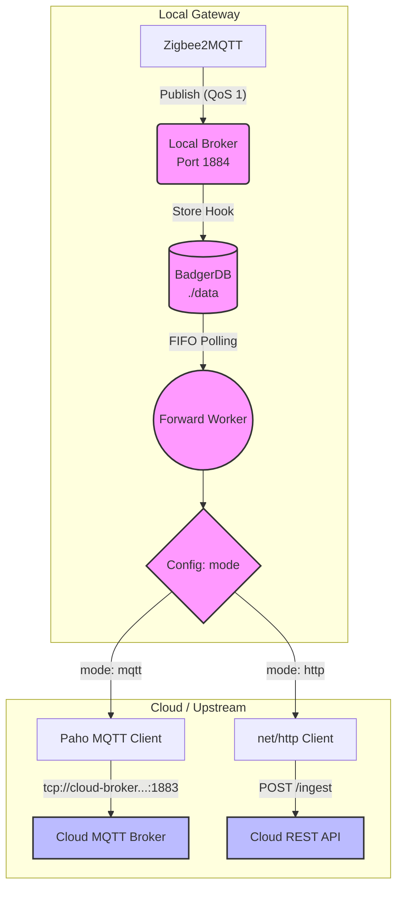

# Configuration (`config.yaml`)

[🇩🇪 Auf Deutsch lesen](configuration.md)

The proxy is completely controlled via a central `config.yaml` file. This file must be located in the same directory as the `proxy` binary.

## Configuration Parameters

```yaml
# The operation mode of the upstream.
# Allowed values: "http" or "mqtt"
mode: "http"

# Note on MQTT mode & timestamps:
# Since we provide offline data later with Store & Forward, the timestamp is important.
# The option mqtt.timestamp_mode controls the behavior:
# - "none": Standard MQTT v3.1.1, timestamp is ignored.
# - "json_inject": (Recommended) Unpacks the payload (if JSON), inserts the timestamp as a Unix timestamp (ms) and repacks it.
# - "v5_property": Sends the message via MQTT v5 and passes the timestamp (RFC3339) as a "User Property" header.

server:
  # (Optional) If false, the web dashboard is completely disabled (Default: true)
  enable: true
  # (Optional) The IP address the web server should bind to (Default: "0.0.0.0" for all interfaces).
  # Without username/password and with public_stats: false it is 127.0.0.1.
  host: "0.0.0.0"
  # The port for the diagnostic web dashboard and the health API
  port: 8097
  # (Optional) Path prefix for the diagnostic REST API (Default: "/api/v1")
  api_prefix: "/api/v1"
  # Public, no login (since 1.2.0, default on): statistics — /status, /stats, /history and, with
  # public_devices, /devices. Customers see whether the proxy runs and forwards.
  # public_stats: true
  # public_devices: true
  # Login for the protected part: live view (/mqtt, every MQTT message), /config, /filters. In the
  # page (session cookie, 12 h) or via HTTP basic auth. Without a password the protected part answers
  # requests from 127.0.0.1 only — behind a reverse proxy always set a password.
  # username: "admin"
  # password: "secret-password"

storage:
  # Path where BadgerDB stores its data (Store & Forward buffer)
  path: "./data"
  # Maximum database size in megabytes
  max_size_mb: 1024

mqtt:
  # Address of the embedded broker (TCP and WebSocket). Default 127.0.0.1: z2m or mqttbridge on the
  # same box. Loopback connections need no login, any other address only with an account from
  # local_users. If bind is reachable from outside and local_users is empty, the proxy refuses to start.
  bind: "127.0.0.1"
  # local_users:
  #   - username: "z2m"          # in zigbee2mqtt: mqtt.user / mqtt.password
  #     password: "secret-password"
  # The local port on which the embedded Mochi broker listens for Zigbee2MQTT.
  # Largest accepted message: 1 MiB.
  local_port: 1884
  # (Optional) Client ID at the upstream. Empty = "mlc2af-proxy-" + the first 12 characters of
  # /etc/machine-id (else hostname); routes append "-route-<name>", remote control "-ctl". Unique per
  # box — two boxes with the same ID keep kicking each other off the broker.
  # client_id: "customer-store-1"
  # Upstream settings (only relevant if mode: "mqtt")
  upstream: "tcp://cloud-broker.example.com:1883"
  username: "user"
  password: "password"
  # How timestamps are sent to the MQTT upstream (none, json_inject, v5_property)
  timestamp_mode: "v5_property"
  # Name of the injected timestamp field in JSON (Default: "_ts").
  # Uses "inject if absent" meaning existing fields are left untouched!
  timestamp_field: "_ts"
  # Enables the use of MQTT 5 Topic Aliases to massively reduce the amount of transmitted data
  topic_alias: true

  # Deduplicates exactly identical messages on the same topic within this time window (in ms).
  deduplicate_interval_ms: 1000
  # Smart JSON Deduplication: These keys are ignored during byte comparison.
  deduplicate_ignore_keys:
    - last_seen
    - linkquality
  # zigbee2mqtt base topic (z2m: mqtt.base_topic) for the device statistics (default: "zigbee2mqtt")
  # zigbee_base_topic: "zigbee2mqtt"
  
  # Optional topic rewrite policy (e.g. redirect to a namespace)
  topic_rewrite:
    match_prefix: "zigbee2mqtt/"
    replace_with: "/v1/bridgedataxxx/"

  # Optional: Filter rules to avoid storing and forwarding unnecessary topics (e.g. logs).
  # These are applied to the incoming (original) topic, BEFORE any topic rewrite.
  filter:
    # Whitelist: Topics MUST start with one of these strings.
    allowed_prefixes:
      - "zigbee2mqtt/"
    # Blacklist: Topics MUST NOT start with any of these strings.
    ignored_prefixes:
      - "zigbee2mqtt/bridge/logging"
      - "zigbee2mqtt/bridge/state"

http:
  # Upstream settings (only relevant if mode: "http")
  endpoint: "https://api.example.com/ingest"
  # Optional: Will be sent as "Authorization: Bearer <token>" header
  token: "my-secret-token"

worker:
  # (Optional) The interval for the background worker in milliseconds (Default: 100)
  interval_ms: 100
  # (Optional) Maximum number of messages to send in a single loop/batch (Default: 100)
  max_batch_size: 50
  # (Optional) Throttling delay in milliseconds between messages within a batch (Default: 0)
  batch_delay_ms: 10
  # (Optional) Minimum backoff time on failures or connection drops in seconds (Default: 1)
  retry_min_s: 1
  # (Optional) Maximum backoff time on failures or connection drops in seconds (Default: 60)
  retry_max_s: 60

# (Optional) Return path: the Sensor Monitor switches devices through the proxy. ON by default,
# works without any settings. See "Return path" below.
control:
  # enabled: true                  # false = return path off (for all routes too)
  # allow: operate                 # operate (default) | writable | list
  # devices:                       # fields per device: added for operate/writable, the only ones for list
  #   "0x00158d0000000001": [child_lock]
  # broker: "tcp://127.0.0.1:1883" # only if zigbee2mqtt is attached to ANOTHER broker
  # username: ""                   # credentials for that broker
  # password: ""
  # subscribe: "cmd/zb/#"          # command subscription on the upstream (default)
  # timeout_s: 10                  # how long the acknowledgement waits for the state report
  # per_minute: 10                 # at most this many commands per device and minute
```

Routes take `control_allow` and `control` (same meaning) and switch only their own `devices`.
`mqtt.downstream_config` no longer exists since 1.5 (it never worked) and is ignored with a
warning.

### Return path: switching devices from the monitor

- **What can be set** (`allow`):
  - `operate` (default): on every device of the tenant the controls `state`, `brightness`,
    `color_temp`, `color`, `position`, `state_<channel>`.
  - `writable`: every field the device itself reports as settable — including settings and
    calibration.
  - `list`: only devices and fields from `devices` (for routes `control`). **Only this makes a
    list restrict**; otherwise it just adds fields. By default the return path never restricts.
- **Which devices:** on the main upstream every device zigbee2mqtt knows; on a route only its
  `devices`. Newly paired devices can be switched without a restart. Which of them actually get
  switched is up to the monitor.
- In every mode the proxy rejects what the device cannot set, devices that are offline or
  unknown, and more than `per_minute` commands per minute.
- **Where commands go:** without `broker` into the proxy's own broker (zigbee2mqtt attached to the
  proxy); with `broker` to that one, e.g. Mosquitto that Home Assistant also uses.
- Flow, acknowledgement and rejection reasons: [mlc-sensor-monitor_en.md › Switching devices](mlc-sensor-monitor_en.md#switching-devices-return-path).

## Architecture Diagram by Operation Mode

The `mode` setting determines which path the worker uses to transmit the data to the cloud. The local data flow (Zigbee2MQTT -> Mochi -> BadgerDB) always remains identical.


